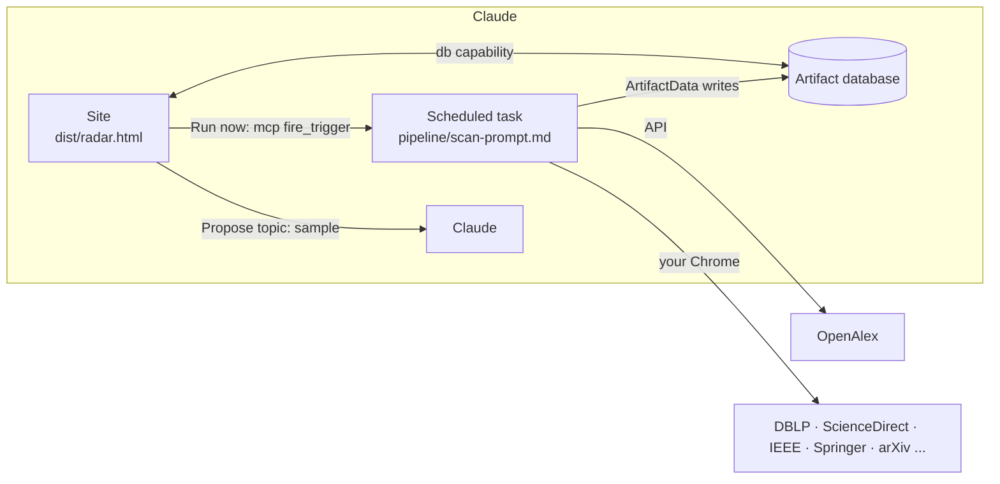

# Research Radar

A literature radar for one research topic. A weekly Claude scan finds new papers, scores how close each one is to your topic, and keeps a website up to date. The site has five pages:

- **Conferences:** a CORE tier list, deadlines for every track, the next edition and the one after, and committees with topic-related people flagged.
- **Journals:** journals ordered by impact factor or topic fit, with special issues and editorial boards.
- **Contributions:** every paper found, with filters, sorting and search by title or author. Each paper has a detail page with:
  - its affinity to your topic;
  - a summary and its main contribution;
  - future work;
  - limitations stated by the authors and limitations identified by the AI;
  - author profiles.
- **Network:** a co-authorship graph of the community, with a people checklist.
- **Topic & scans:** your topic profile, plus:
  - deriving the topic from seed papers;
  - rescoring, removing or re-searching papers when the topic changes;
  - choosing sources and entering API keys;
  - the scan log;
  - data export.

Conferences and journals both have an *Emerging* section. Records the scan could only partly collect are flagged: a paper analysed from its abstract alone is marked **Partial**, and its author-stated fields show as *unknown* rather than *none stated*.

Nothing in the code is tied to one topic. To use it for another topic, see [docs/new-topic.md](docs/new-topic.md).

## Install

Clone and configure everything with one prompt. Paste this into Claude Code, and the agent asks you a few multiple-choice questions, then clones the repo, builds the page, publishes the artifact and creates the scheduled scan:

```text
I want to set up Research Radar for my own research topic. Clone the repo and
configure everything, then tell me what is left for me to do by hand.

Repo: https://github.com/alvarobernal2412/research-radar

Before you do anything else, ask me for the values below. Use the
AskUserQuestion tool (multiple-choice with an "Other" free-text option) in two
calls, because it takes at most 4 questions each. If that tool is not
available, ask the same questions in plain text in one message. Mark the
suggested option "(Recommended)" and wait for my answers.

Call 1:
1. Clone folder: ~/code/research-radar (Recommended) / the current directory /
   Other.
2. Scan schedule: Sundays 09:00 (Recommended) / Mondays 09:00 / daily 07:00 /
   Other. Also ask my time zone if you cannot read it from this machine.
3. Look-back window in years: 3 (Recommended) / 2 / 5 / Other.
4. Minimum affinity, 0-100: 35 (Recommended) / 50 / 20 / Other.

Call 2:
5. Local mirror (docker compose in infra/): No (Recommended) / Yes.
6. Site name and a short tagline for my topic: offer one or two suggestions
   (for example "Process Radar" / "your topic in a few words") and let me type
   my own under Other.
7. My name exactly as it appears on papers, so the network marks me: use my
   git user.name (Recommended, if set) / skip, I will add it on the site /
   Other, to type it.

Steps:
1. git clone the repo into the folder I gave you, then read README.md and
   docs/new-topic.md.
2. Check python 3.11+ is installed (node and docker are optional). Install
   nothing system-wide without asking me. Run: python -m pytest
3. Copy config/site.example.json to config/site.json and fill in title,
   siteName, tagline, scheduleText, timezone, lookbackYears and minAffinity
   from my answers. config/site.json is git-ignored: never commit it.
4. Build: python site/build.py --check
5. Publish dist/radar.html as a NEW artifact with the capabilities in
   site/capabilities.json. Put the returned URL into config/site.json as
   artifactUrl. If config/site.json already has a real artifactUrl (this is a
   re-run), read that artifact first and update it in place instead of
   creating a second one.
6. Run python pipeline/render_prompt.py and create a scheduled task named
   "<site name> weekly scan" at my schedule, using that output as its prompt.
   It must run on my computer (the Chrome sources need it). Put the task id
   into config/site.json as triggerId.
7. Write meta/config to the artifact's database with {siteName, tagline,
   triggerId, scheduleText, lookbackYears, minAffinity} from config/site.json.
8. If I asked for the local mirror, set it up (docker compose in infra/) and
   append infra/scan-mirror-step.md to the task prompt as step 9, as the
   README describes.
9. Finish with a short checklist of what I still have to do myself. It must
   include: set the topic on the site (Topic & scans) and add my name there,
   enter my OpenAlex key there, then press "Run now" for the first scan (the
   radar is empty until a scan has run), and note that the artifact is private
   until I share it from its Share menu.

Rules:
- Never commit .env, infra/.env, config/site.json or any API key.
- Do not ask me to paste my OpenAlex key into the chat. Tell me to enter it on
  the site (Topic & scans, then Sources).
- Do not run git commit yourself: show me the proposed message and wait.
```

Prefer to do it yourself?

```bash
git clone https://github.com/alvarobernal2412/research-radar.git && cd research-radar
cp config/site.example.json config/site.json   # then edit it
python site/build.py --check
```

and continue with [docs/new-topic.md](docs/new-topic.md). What the prompt cannot do for you (API key, topic, task approval) is listed in [docs/setup-prompt.md](docs/setup-prompt.md).

## How it works



- The **site** is one HTML page published as a Claude artifact. It reads and writes the artifact's database through the runtime's `db` capability. It can't reach the web itself.
- The **scan** is a Claude scheduled task. Its instructions are [pipeline/scan-prompt.md](pipeline/scan-prompt.md). It searches OpenAlex first, then the sources you enabled through your Chrome. It de-duplicates the results, reads the papers and writes them to the database.
- The site talks to the scan through `meta/control`, for example "rescore everything" or "retry these papers". "Run now" starts the task immediately.
- **Secrets** such as the OpenAlex key are entered on the site and stored in `data/users/<you>/settings`, which only you can read. They never enter this repository or the export. The scheduled scan reads the key from there, not from `.env`; the root `.env` is only for running the OpenAlex CLI from your own machine.

More detail: [docs/architecture.md](docs/architecture.md). Data model: [pipeline/schema/radar.schema.json](pipeline/schema/radar.schema.json).

## Repository layout

```
site/
  src/index.html        page template ({{TITLE}}, {{STYLES}}, {{SCRIPTS}})
  src/styles/*.css      main.css first, then alphabetical
  src/js/NN-*.js        concatenated in numeric order into one strict-mode scope
  build.py              assembles dist/radar.html (standard library only)
  vendor.json           pinned CDN libraries (d3 eager, pdf.js lazy)
  capabilities.json     runtime capabilities to declare when publishing
pipeline/
  scan-prompt.md        the scheduled scan's instructions ({{ARTIFACT_URL}})
  render_prompt.py      fills in the prompt from config/site.json
  radar/openalex.py     OpenAlex client + mapping to paper records (+ CLI)
  radar/dedup.py        duplicate detection and stable document ids
  radar/scoring.py      affinity formula and completeness rules
  schema/               JSON Schema of every stored document and the export file
config/
  site.example.json     template for your deployment settings (no secrets)
  site.json             your deployment (artifact URL, task id, names); git-ignored, create it from the example
infra/                  optional local mirror: docker compose, Postgres, document API (see below)
tests/
  test_pipeline.py      pytest for the pipeline helpers
  smoke/smoke.js        end-to-end test of the built page against a mocked runtime
  fixtures/             sample OpenAlex work and paper records
docs/                   architecture, new-topic walkthrough, one-prompt setup guide
data/                   put exported JSON snapshots here (git-ignored unless you add them)
.env.example            OpenAlex key and contact email for running the CLI locally (copy to .env, git-ignored)
LICENSE                 AGPL-3.0-or-later
```

## Working on it

```bash
python site/build.py --check            # build dist/radar.html and syntax-check it
python -m pytest                        # pipeline tests
npm install && npm run smoke            # end-to-end test (set CHROMIUM=/path/to/chrome if needed)

# OpenAlex from your own machine (copy .env.example to .env and set OPENALEX_API_KEY, or export it)
cd pipeline && python -m radar.openalex search "analytic provenance" --since 2025-01-01 --max 20
```

**Publishing a change.** Build, then ask Claude to publish the page:

> Publish `dist/radar.html` to `<artifactUrl from config/site.json>`. Read the live version first and keep its data.

The page's data lives in the database, not in the HTML, so republishing never loses papers. Only pass `capabilities` (from `site/capabilities.json`) when you change what the page declares.

**Changing the scan.** Edit `pipeline/scan-prompt.md`, run `python pipeline/render_prompt.py`, and ask Claude to update the scheduled task's prompt with the output. A task that runs on your computer must be approved from a conversation linked to that computer.

## Local mirror (optional)

`infra/` holds a docker compose stack (Postgres plus a small web service) that keeps a durable, offline copy of your radar and serves the page against it. It is meant to sit next to the Claude scheduled task, not replace it: the task still scans, analyses and writes into the artifact's database, and the stack is where a copy of the result lands. Details are in [infra/README.md](infra/README.md).

```
scheduled Claude task ──writes──▶ artifact database (source of truth)
        │
        └─ final step ──copies──▶ local Postgres + files volume ──▶ http://127.0.0.1:8787
```

To make the scheduled task feed the mirror, append the step in [infra/scan-mirror-step.md](infra/scan-mirror-step.md) to the task prompt. Placeholder example, to pass to Claude when you create or update the task:

> Update my scheduled task "<site> weekly scan". Keep its current prompt and append the contents of `<REPO_PATH>/infra/scan-mirror-step.md` as step 9 (after "Check and report"), with these values filled in:
> - `{{ARTIFACT_URL}}` = `<ARTIFACT_URL>` (artifactUrl in config/site.json)
> - `<REPO_PATH>` = `<ABSOLUTE PATH TO THIS REPO ON THE MACHINE THE TASK RUNS ON>`
> - `<MIRROR_DIR>` = `<A SCRATCH FOLDER OUTSIDE THE REPO, e.g. ~/radar-mirror-scratch>`
>
> The task must run on my computer (Docker and the stack need to be running there). If the import fails, it should report that and finish normally.

The stack does not need to be running for scans to work; a failed mirror step never affects the artifact.

## Limits worth knowing

- Browser sources (DBLP, ScienceDirect, IEEE Xplore, SpringerLink, ACM, arXiv, Scholar, Scopus) are read through Chrome on your computer, so your computer must be on with Chrome open during a scan. OpenAlex doesn't need either.
- Paywalled papers are analysed from the abstract unless your Chrome session has institutional access. They show as Partial.
- `impactFactor` is only filled in from JCR or publisher pages. OpenAlex's 2-year mean citedness is stored separately and labelled as such.

## License

GNU Affero General Public License v3.0 or later. See [LICENSE](LICENSE).
